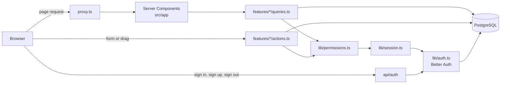

# Architecture

## Overview

A single Next.js application. Server Components read from PostgreSQL through Drizzle and render HTML. Client Components call Server Actions to change data. There is no separate API layer; the only route handler is the one Better Auth needs.



## Folder structure

```
drizzle/                 SQL migrations generated by drizzle-kit (committed)
docs/                    this documentation
scripts/seed.ts          demo data
tests/                   unit and integration tests
src/
  proxy.ts               redirects visitors without a session cookie to /login
  app/                   routes only: pages, layouts, loading and error states
    (auth)/              /login and /signup
    (app)/               everything behind sign-in; its layout checks the session
      projects/                          project list
      projects/[projectId]/              board (page), list/, settings/, tasks/[taskId]/
      projects/[projectId]/@modal/       the card dialog (see "The card dialog")
    api/auth/[...all]/   Better Auth HTTP handler
  db/
    index.ts             connection pool and Drizzle client
    schema/              table definitions, one file per area
  lib/                   cross-cutting code: env, auth, session, permissions, action helpers
  features/              one folder per domain area
    projects/  members/  tasks/  comments/
      schemas.ts         Zod schemas for input
      queries.ts         reads, called from Server Components
      actions.ts         writes, exposed as Server Actions
      components/        UI specific to the feature
  components/
    ui/                  primitives: button, input, dialog, menu, badge, avatar ...
    shell/               top bar, sidebar, user menu, theme toggle
    reactbits/           animated components copied from React Bits
    providers.tsx        theme, tooltips and toasts
```

`src/app` holds routing and page composition. Business logic lives in `src/features`. The dependency direction is `app → features → lib → db`; features do not import from `app`.

## The data access rule

**Pages and components never import `db`.** They call a function from a feature's `queries.ts` or `actions.ts`, and every one of those functions starts by establishing who is asking and whether they may:

| Guard (in `src/lib`) | Used by | When access is refused |
|---|---|---|
| `requireUser()` | anything not tied to a project | redirects to `/login` |
| `requireProjectAccess(projectId)` | queries | renders the 404 page |
| `requireProjectMember(projectId)` | actions | returns the error "Project not found." |
| `requireProjectOwner(projectId)` | owner-only actions | returns the error "Only the project owner can do this." |

Because the check is inside the function, a new page cannot forget it. This matters most for Server Actions: each one is a public HTTP endpoint that can be called with any arguments, regardless of which buttons the UI shows.

Two details worth knowing:

- Someone who is not a member gets the same response as for a project that does not exist, so project ids cannot be probed.
- Records below a project are always looked up together with the project id (`where task.id = ? and task.project_id = ?`). Membership of one project therefore never gives access to another project's tasks or comments.

## Authentication

Better Auth handles accounts and sessions. Configuration is in `src/lib/auth.ts`; its tables live in the same database (see [database.md](database.md)).

- **Sign in, sign up, sign out** happen in the browser through `authClient` (`src/lib/auth-client.ts`), which calls `/api/auth/*`. Passwords are hashed by Better Auth and the session is an HTTP-only cookie.
- **Reading the session on the server** goes through `getSession()` and `requireUser()` in `src/lib/session.ts`. They are wrapped in React's `cache()`, so a layout, a page and several queries in one request cost a single lookup.
- **`src/proxy.ts`** (Next.js 16's name for middleware) only checks that a session cookie is present and redirects to `/login` if not. It is a fast path, not the security boundary: it cannot tell a valid cookie from a forged one. The guards above do the real check against the database.

## Permissions

| Action | Owner | Member |
|---|---|---|
| View project, tasks, members, comments | yes | yes |
| Create, edit, move, delete tasks | yes | yes |
| Comment; delete own comments | yes | yes |
| Rename or delete the project | yes | no |
| Add or remove members | yes | no |

A project has exactly one owner, the person who created it. The owner cannot be removed. When a member is removed, their tasks stay in the project and become unassigned. A task can only be assigned to a member of its project.

## Server Actions and errors

Every action wraps its body in `runAction()` from `src/lib/action.ts` and returns an `ActionResult`:

```ts
type ActionResult<T> =
  | { ok: true; data: T }
  | { ok: false; error: string; fieldErrors?: Record<string, string[]> }
```

`runAction` converts failures into that shape:

- `AppError`, thrown for expected problems such as "That person is already a member", becomes `error` with its message.
- A Zod validation failure becomes a general `error` plus `fieldErrors` for the form to show next to each input.
- Anything else is logged on the server and reported as "Something went wrong", so internal details never reach the browser.

Forms call the action inside `useTransition`, then either show the error or continue. After a successful write the action calls `revalidatePath`, and Next.js re-renders the affected pages with fresh data.

## The kanban board

Each task has a `status` (its column) and a `position` (its zero-based index in that column).

`moveItem()` in `src/features/tasks/position.ts` is a pure function that takes the columns, a task id, a target column and a target index, and returns the new columns. It is used in two places so they cannot disagree:

1. `Board` (`src/features/tasks/components/board.tsx`) applies it immediately when a card is dropped, so the UI does not wait for the server.
2. The `moveTask` action applies it to the rows it has just read and locked (`SELECT ... FOR UPDATE`) inside a transaction, then writes back only the rows whose column or index changed.

If the action fails, the board restores the order from before the drag and shows the error. Creating a task appends it to its column; deleting one or changing its status through the edit form renumbers the affected columns the same way.

## The card dialog

A task has one URL, `/projects/[projectId]/tasks/[taskId]`, and two presentations:

- **Opened from inside the project** (a card on the board, a row in the list), it appears in a dialog over the current page. The `@modal` parallel route slot in the project layout holds an intercepting route, `@modal/(.)tasks/[taskId]`, which Next.js renders instead of leaving the page. Closing the dialog calls `router.back()`.
- **Loaded directly** (a shared link, a reload), the ordinary page `tasks/[taskId]/page.tsx` renders.

Both render the same server component, `TaskDetail`, so there is one implementation. `@modal/default.tsx`, `@modal/page.tsx` and `@modal/[...catchAll]/page.tsx` return nothing; they empty the slot on a direct load and when navigating to another page of the project.

## Interface

The app shell (`src/components/shell`) is a top bar and a sidebar listing the user's projects; the page scrolls inside it. Looks are defined once as design tokens in `src/app/globals.css` for light and dark, documented in [DESIGN.md](../DESIGN.md). A project's colour and a person's avatar colour are derived from their id (`src/lib/color.ts`), not stored.

## Known limitations

- A page for a project you cannot access shows the "Page not found" screen but with HTTP status 200, because the response has already started streaming the loading state. No project data is sent.
- The board does not update live when someone else changes it; it refreshes on navigation or after your own next change.
