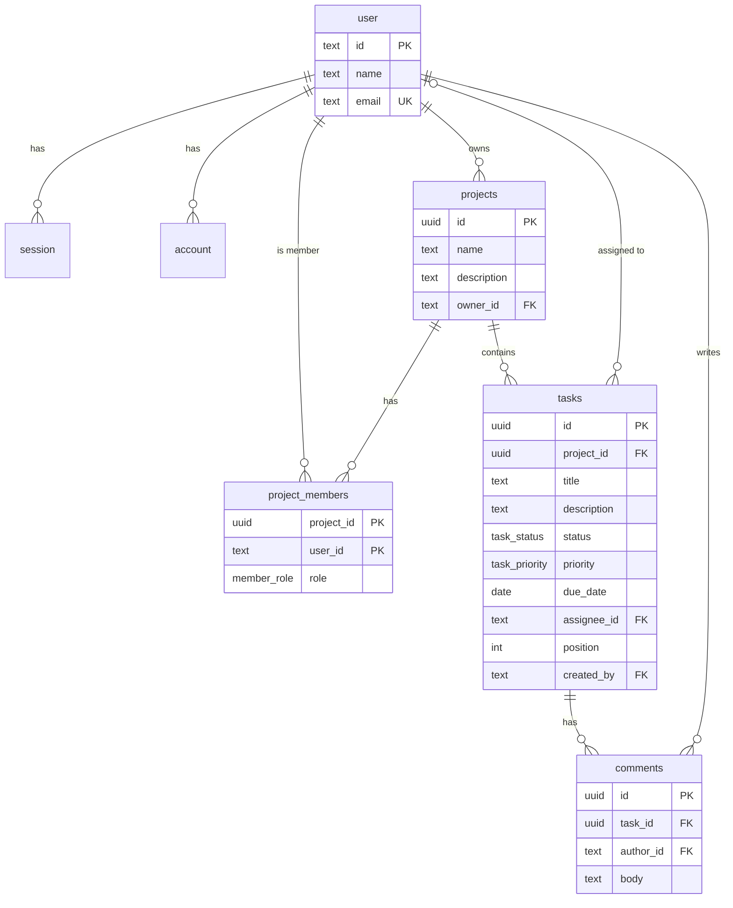

# Database

PostgreSQL 17, accessed through Drizzle ORM. Table definitions are TypeScript files in `src/db/schema/`; the SQL that creates them is generated into `drizzle/`.

## Diagram



## Auth tables

`user`, `session`, `account` and `verification` belong to Better Auth. Their definitions in `src/db/schema/auth.ts` are generated; do not edit them by hand (see "Changing the auth schema" below).

| Table | Holds |
|---|---|
| `user` | One row per person: name, unique email. Ids are text, generated by Better Auth. |
| `session` | Active sign-in sessions with their token and expiry. |
| `account` | How a user signs in. For email and password, the password hash is here. |
| `verification` | Short-lived tokens for flows such as email verification. Unused in the MVP. |

## Application tables

### `projects`

| Column | Type | Notes |
|---|---|---|
| `id` | uuid | Primary key, generated by the database |
| `name` | text | Required |
| `description` | text | Defaults to an empty string |
| `owner_id` | text | → `user.id`, cascade on delete |
| `created_at`, `updated_at` | timestamptz | |

### `project_members`

Who can access a project. The owner has a row here too, with role `owner`, so one query answers "is this user allowed in?".

| Column | Type | Notes |
|---|---|---|
| `project_id` | uuid | → `projects.id`, cascade on delete |
| `user_id` | text | → `user.id`, cascade on delete |
| `role` | `member_role` | `owner` or `member` |
| `created_at` | timestamptz | |

Primary key `(project_id, user_id)`. Index on `user_id` for listing a user's projects.

### `tasks`

| Column | Type | Notes |
|---|---|---|
| `id` | uuid | Primary key |
| `project_id` | uuid | → `projects.id`, cascade on delete |
| `title` | text | Required |
| `description` | text | Defaults to an empty string |
| `status` | `task_status` | `todo`, `in_progress` or `done`; the board column |
| `priority` | `task_priority` | `low`, `medium` or `high` |
| `due_date` | date | Optional calendar date, no time or time zone |
| `assignee_id` | text | Optional → `user.id`; set to null if the user is deleted |
| `position` | integer | Zero-based index inside the status column |
| `created_by` | text | → `user.id`, cascade on delete |
| `created_at`, `updated_at` | timestamptz | |

Index on `(project_id, status, position)`, which is the order the board reads in.

Within one project and status, positions run 0, 1, 2 and so on with no gaps. Every action that changes a column renumbers it in the same transaction. `updated_at` therefore also changes on tasks that were only shifted by a neighbour's move.

### `comments`

| Column | Type | Notes |
|---|---|---|
| `id` | uuid | Primary key |
| `task_id` | uuid | → `tasks.id`, cascade on delete |
| `author_id` | text | → `user.id`, cascade on delete |
| `body` | text | Required |
| `created_at` | timestamptz | |

Index on `(task_id, created_at)`.

## What deleting removes

- Deleting a **project** removes its memberships, tasks and their comments.
- Deleting a **task** removes its comments.
- Deleting a **user** removes their sessions, the projects they own, their memberships, the tasks they created and their comments, and unassigns them from other tasks. The app has no "delete account" screen yet; this is what the database would do.

## Changing the schema

1. Edit or add a file in `src/db/schema/`. A new file must be exported from `src/db/schema/index.ts`.
2. Run `npm run db:generate -- --name short_description`. This writes a new SQL file to `drizzle/`.
3. Read the generated SQL. Check that it does what you intended, especially for renames, which drizzle-kit may ask you to confirm.
4. Run `npm run db:migrate` to apply it.
5. Commit the schema change and the migration together.

Never edit a migration that has been applied anywhere else; add a new one. `drizzle/meta/` is drizzle-kit's record of the schema at each migration and must be committed too.

Tests build their database from the `drizzle/` folder, so a schema change without a generated migration makes them fail.

## Changing the auth schema

If you enable a Better Auth plugin or option that needs new columns, regenerate the file instead of editing it:

```bash
npx auth@latest generate --config src/lib/auth.ts --output src/db/schema/auth.ts -y
```

Then continue from step 2 above.

## Looking at the data

`npm run db:studio` opens Drizzle Studio in the browser. From a terminal:

```powershell
& "C:\Program Files\PostgreSQL\17\bin\psql.exe" -U pm_tool -d pm_tool
```
